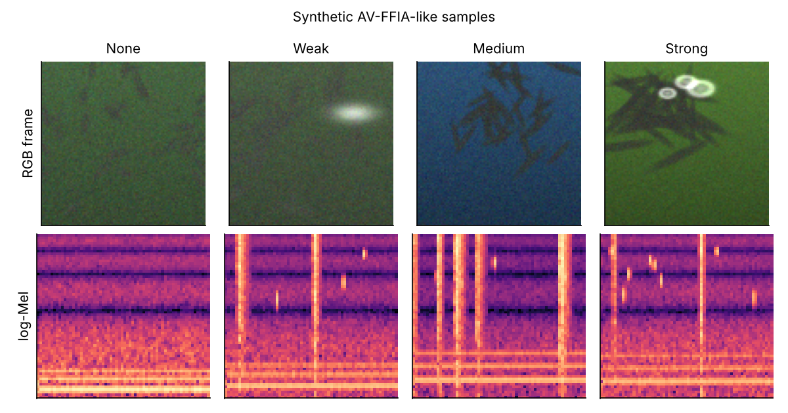
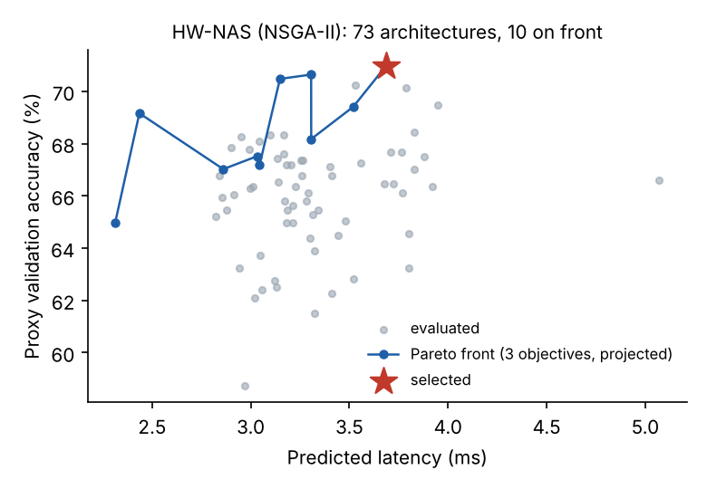
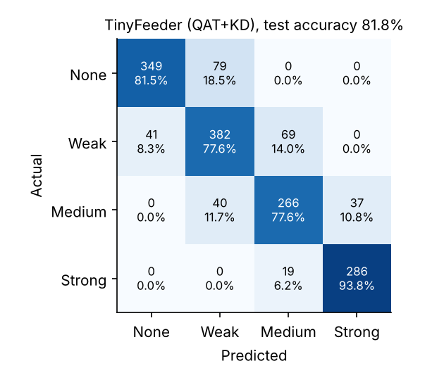
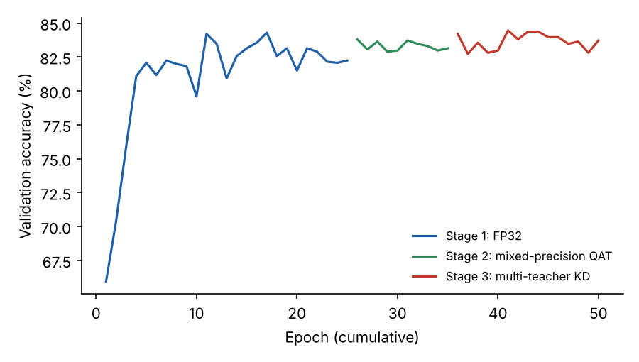
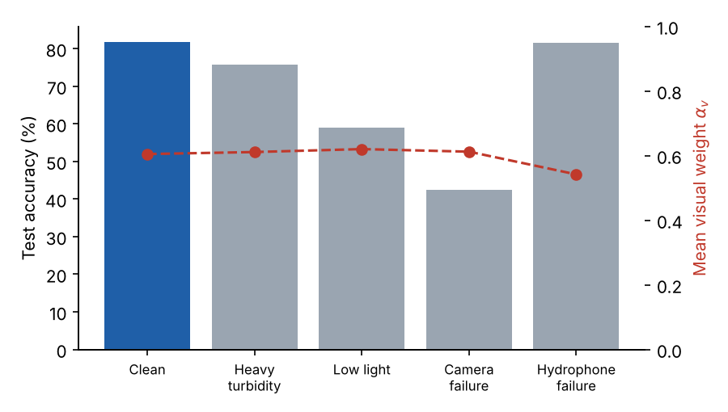

# TinyFeeder

**Hardware-aware neural architecture search, mixed-precision quantization-aware training and multi-teacher distillation for multimodal fish feeding-intensity recognition on edge devices.**

[](https://github.com/Drwae/TinyFeeder/actions/workflows/ci.yml)
[](https://doi.org/10.5281/zenodo.23640937)
[](LICENSE)

Reference implementation of

> W. M. Elmessery, A. M. Alnemari, H. A. Hassanien, A. O. Abbas, A. T. Mansour, M. Ashour, F. M. Gebru, M. M. Mahmoud.
> *Tiny Feeder: Hardware-Aware Neural Architecture Search for Ultra-Lightweight Fish Feeding Intensity Recognition on Edge Devices.* Scientific Reports (2026).

TinyFeeder classifies fish feeding intensity (none / weak / medium / strong) from a synchronized RGB frame and an underwater-acoustic log-Mel spectrogram, and is compressed in three stages so that it runs in real time on a Jetson Nano, Raspberry Pi 4 or Coral Edge TPU.



## Pipeline

| Stage | What it does | Code |
|---|---|---|
| 0 Data | video-level, leakage-free train/val/test split (64/16/20) | `tinyfeeder/data/` |
| 1 HW-NAS | NSGA-II over IR / MBConv / DWSep blocks; objectives: accuracy, predicted latency, parameters; gradient-boosted latency predictor trained on device profiles | `tinyfeeder/nas/search.py` |
| 2 Mixed-precision QAT | per-layer INT8 sensitivity analysis, most sensitive 15% of layers in FP16, symmetric per-channel weights, asymmetric EMA-observed activations, STE | `tinyfeeder/quant/fakequant.py` |
| 3 Multi-teacher KD | ensemble soft targets (τ = 4), feature hints with learned projections, attention transfer; two-phase β schedule | `tinyfeeder/distill/losses.py` |
| Deploy | ONNX → TensorRT (INT8/FP16), ONNX → TFLite / Edge TPU, real-time feeding controller with confidence fallback | `deploy/` |

`scripts/run_pipeline.py` chains every stage; each stage writes its artefacts to `runs/<name>/` and is skipped if they already exist.

## Quick start (synthetic data, CPU, ~1-2 h)

```bash
git clone https://github.com/Drwae/TinyFeeder.git && cd TinyFeeder
pip install -e ".[dev]"
pytest -q                                                       # unit tests
python scripts/run_pipeline.py --config configs/demo_synthetic.yaml
python scripts/make_figures.py --run runs/demo_synthetic --data data/synthetic/avffia_synth.npz
```

The demo generates a synthetic AV-FFIA-like dataset (240 sessions, 7,680 paired samples, three synthetic farms; see [docs/DATA.md](docs/DATA.md)) and runs the full pipeline at reduced resolution (96 px frames, 64×64 spectrograms) with small torchvision teachers.

## Demonstration run on synthetic data

> ⚠️ **These numbers come from synthetic data and a CPU-sized configuration. They demonstrate that the pipeline runs end-to-end; they are not, and must not be quoted as, the results of the article, which were obtained on the AV-FFIA farm recordings with `configs/paper.yaml`.**

| Model | Params | Size (MB) | Test acc. (%) | Macro-F1 | Weighted-F1 |
|---|---:|---:|---:|---:|---:|
| Teacher: resnet18 | 11.57M | 46.3 | 84.8 | 0.852 | 0.847 |
| Teacher: mobilenet_v3_large | 3.37M | 13.5 | 74.6 | 0.735 | 0.744 |
| Teacher: shufflenet_v2_x1_0 | 1.65M | 6.6 | 83.4 | 0.835 | 0.833 |
| TinyFeeder, Stage 1 (FP32, NAS arch.) | 199K | 0.80 | 83.8 | 0.842 | 0.838 |
| TinyFeeder, Stage 2 (+ mixed-precision QAT) | 199K | 0.21 | 82.1 | 0.826 | 0.822 |
| **TinyFeeder, Stage 3 (+ multi-teacher KD)** | 199K | 0.21 | 81.8 | 0.824 | 0.818 |

- Data: 153/38/49 videos (train/val/test), 1568 test samples; video overlap between train and test: 0.
- HW-NAS: 73 architectures evaluated, 10 on the Pareto front; latency predictor (XGBoost, 300 profiled architectures) hold-out MAPE 9.7%.
- Selected architecture: 199K parameters (62K visual, 116K acoustic, 21K fusion), 70.8 MFLOPs at 96 px.
- Mixed precision: 5 of 32 layers in FP16; deployment size 0.21 MB vs 0.80 MB FP32. Same-budget ablations (val. acc.): int8 per channel 84.1%, int8 per tensor 83.9%.
- Final model: test accuracy 81.8% (bootstrap 95% CI 79.9–83.7%); ONNX Runtime CPU latency 0.84 ms (median, host CPU, batch 1).
- Modality reliance: mean visual weight α_v 0.60 on clean inputs, 0.61 under added turbidity; accuracy with camera failure 42.4%, with hydrophone failure 81.6%.

<p align="center">
 <br>
 
</p>

The complete outputs of this run (`splits.json`, NAS search log and Pareto front, sensitivity analysis, training histories, test predictions, ONNX model and the final checkpoint) are in [`runs/demo_synthetic/`](runs/demo_synthetic).

## Reproducing the article

1. Obtain the AV-FFIA recordings (see [docs/DATA.md](docs/DATA.md)) and convert them to the documented `.npz` layout.
2. On the target device, profile the search space for the latency predictor:
   `python deploy/profile_device.py --n 5000 --img 224 --mel 128 --out jetson_latency.csv`
3. `pip install -e ".[paper]"` (adds `timm` for the ResNeSt50 / Swin-T / ConvNeXt-Base teachers) and run
   `python scripts/run_pipeline.py --config configs/paper.yaml` on a GPU server.
4. Deploy: `python deploy/calibrate.py --config configs/paper.yaml` then `bash deploy/build_tensorrt.sh runs/paper/tinyfeeder.onnx` on the Jetson; see [deploy/to_tflite.md](deploy/to_tflite.md) for Raspberry Pi / Coral.

## Repository layout

```
tinyfeeder/
  models/      TinyFeeder (visual encoder, acoustic encoder, gated fusion), teachers
  data/        synthetic generator, dataset + augmentation, video-level split
  nas/         search space, latency predictor, NSGA-II, constrained selection
  quant/       fake-quantization (INT8 / FP16), sensitivity analysis helpers
  distill/     multi-teacher KD losses and β schedule
  engine.py    training / evaluation loops, metrics, latency and FLOP counting
scripts/       run_pipeline.py, make_figures.py
deploy/        TensorRT build, calibration, TFLite notes, device profiler, feeding controller
configs/       demo_synthetic.yaml, paper.yaml
runs/          outputs of the synthetic demonstration run
tests/         unit tests (split leakage, QAT, KD, NSGA-II, model)
```

## Citation

Please cite the article (see [CITATION.cff](CITATION.cff)) and this software:

```bibtex
@software{tinyfeeder_code_2026,
  author  = {Elmessery, Wael M. and Alnemari, Ashwaq M. and Hassanien, Hesham A. and Abbas, Ahmed O. and
             Mansour, Abdallah Tageldein and Ashour, Mohamed and Gebru, Fsaha Mebrahtu and Mahmoud, Mohamed Metwally},
  title   = {TinyFeeder: reference implementation},
  year    = {2026},
  version = {1.0.0},
  doi     = {10.5281/zenodo.23640937},
  url     = {https://github.com/Drwae/TinyFeeder}
}
```

## License

Code: MIT. Synthetic data generated by this repository: CC BY 4.0.
